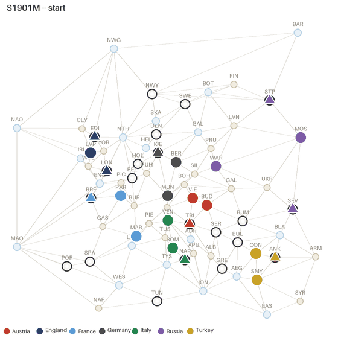
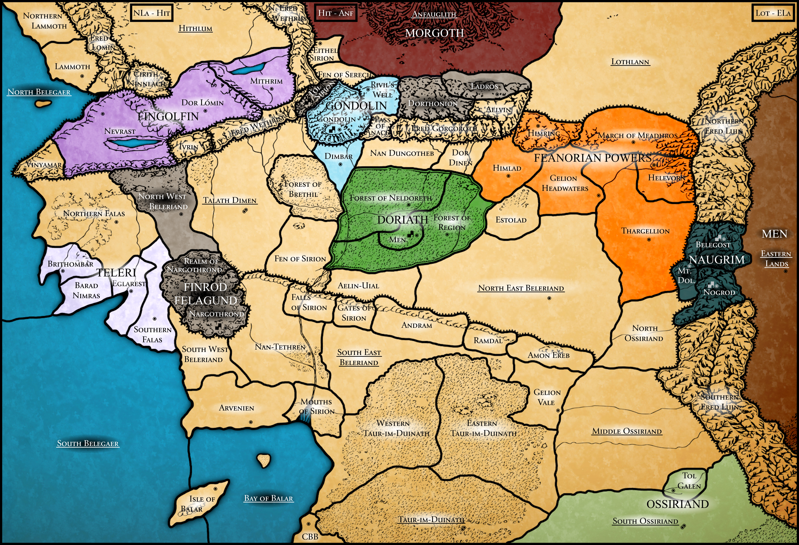
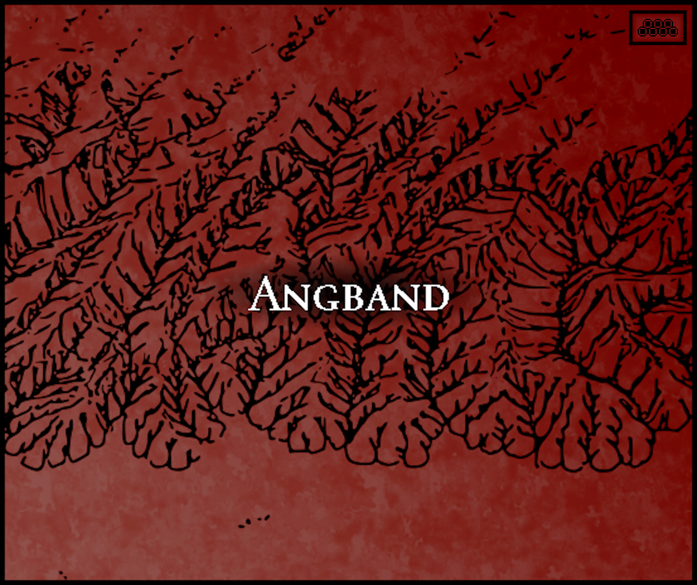
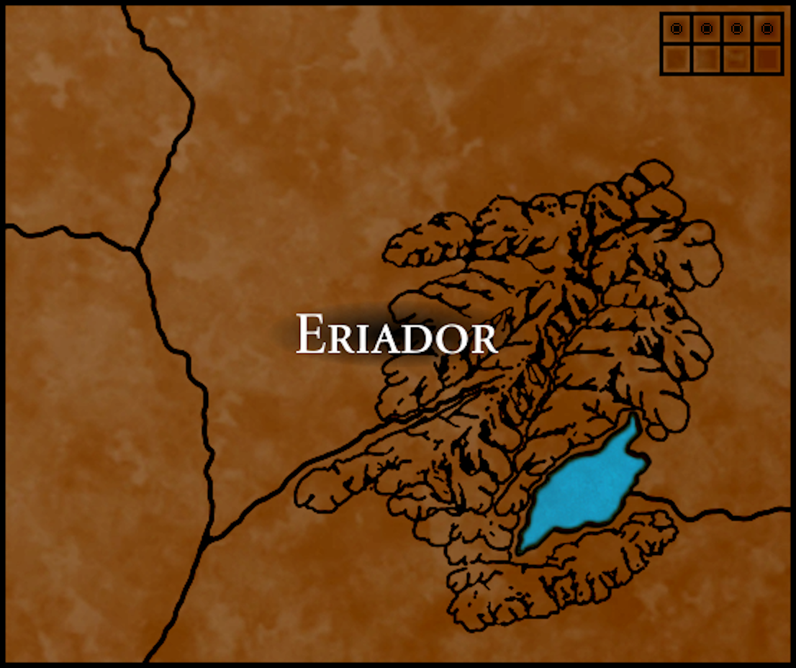

# entente

A Diplomacy engine written from scratch, my own 10-player Tolkien variant running on the same
engine, and a few AI agents that learn to play.



*Seven copies of my heuristic bot playing each other, 1901-1907. One frame per phase; the
colour of an arrow says whether the order worked.*

## What is this about?

[Diplomacy](https://en.wikipedia.org/wiki/Diplomacy_(game)) is a board game from the 1950s:
seven players, a map of Europe and no dice. Everybody writes down orders for their units in
secret, and then all the orders are carried out at the same time.

I picked it for two reasons.

**Deciding what happens is a real problem.** A moves, B supports A, C cuts that support, but
C is itself being pushed out by D, whose support comes from... Orders depend on one another,
sometimes in a circle, and there are known positions where the rules, read word for word,
contradict themselves. The step that sorts all of this out is called *adjudication*, and
getting it exactly right is harder than it looks.

**It is a hard game for AI.** Seven players, simultaneous moves, a huge number of possible
joint moves every turn, and nobody gets far without allies. It is the game behind Meta's
CICERO (2022).

So the project has two halves: an engine that gets the rules exactly right, and agents that
play on top of it.

## What is inside

### 1. The engine

I did not want a pile of special cases, so the rules are first written down as mathematics.
Every unit has a strength, every province has a capacity, and an outcome is *stable* when
you can assume it, check every rule, and get the same outcome back. When exactly one outcome
is stable, that is the answer; when several are, or none at all (the contradictions above),
a fixed tie-break rule settles what the rules leave open. All of it is in a LaTeX
specification with definitions, lemmas and theorems
([docs/adjudication.pdf](docs/adjudication.pdf), some 60 pages).

The specification is then implemented twice:

- a slow version that tries the possible outcomes and keeps the stable ones, which is the
  definition almost word for word;
- a fast version that works out, step by step, everything that is forced, and tries outcomes
  only for the few orders that are really tangled. This is the one the game uses.

The two have to agree on every conformance case of the move rules and on thousands of
randomly generated positions.
That comparison found real bugs that no hand-written test had caught.

For classic Diplomacy the engine passes all 176 cases of the
[DATC](https://webdiplomacy.net/datc.php), the test suite that Diplomacy adjudicators are
measured against: both versions pass the 156 cases about moves and retreats, and the 20
about winter builds and disbands go through the one build step they share. Where the DATC
leaves a choice open, each case records mine ([docs/datc-choices.md](docs/datc-choices.md)
lists them all), and in six cases that is not the answer the DATC prefers.

### 2. Beleriand

The reason for all the generality: I have a Diplomacy variant of my own, set in Tolkien's
Beleriand. Ten players instead of seven, units of strength 1, 2 and 3, big provinces that
hold up to six units at once (two of them any number), mountains that halve an attack,
fortresses, and two new orders (one pushes a chosen unit out of a crowded province, the
other keeps a chosen unit from coming in). The rulebook is in the repository:
[BeleriandInstruction.docx](BeleriandInstruction.docx).



*The board of my variant. The borders, names, supply centres, fortresses and colours are mine;
the background map is not: it is made from the maps of Karen Wynn Fonstad's* The Atlas of
Middle-earth*, joined, cleared of names and coloured by
[u/Tolkien_erklaert](https://www.reddit.com/r/lotr/comments/ezjjl3/so_i_put_together_the_maps_of_the_historical/).*

<p>


</p>

*Angband and Eriador, the two provinces off the board.*

It runs on the same adjudication code as the classic game, with no "if this is Beleriand"
anywhere in it. Classic Diplomacy is simply the case where every strength is 1 and every
province holds one unit, and the specification shows that the general rules then give the
classic ones back.

No other program plays this variant, so there was nothing to compare the results with. That
is the main reason for two implementations that check each other, next to about 300 test
positions derived by hand from the rulebook.

### 3. The agents

Built in steps, each one checked before the next:

- **Regret matching and CFR**, tested on Kuhn poker, a tiny game whose exact solution is
  known.
- **A heuristic bot** ("greedy"), written by hand, as the baseline to beat.
- **A small transformer that imitates people** (behavioural cloning), trained on about 9,000
  recorded human games. It cannot produce an illegal order: its choices are masked with the
  engine's own list of legal orders.
- **piKL search**, after Jacob et al. (2022), the planning idea that CICERO was later built
  on. The agent looks one turn ahead and searches for a good joint plan, but is pulled back
  towards what a human would play. It is implemented from the paper and was first tested on
  small games with known answers ([docs/pikl.pdf](docs/pikl.pdf)).
- **A negotiation prototype**: a small language model fine-tuned to write Diplomacy
  messages, a reader for proposals written in a fixed format, and an experiment that
  measures whether talking helps (so far: a little, and not significantly). The experiment
  uses the fixed-format messages, not the language model. It is a prototype, not a finished
  player.

## Some numbers

Every number below comes from the raw result files in [docs/results/](docs/results/).
Scores are Sum-of-Squares shares (each player's supply centres squared, as a share of the
total), so seven equal players would get 1/7 = 0.143 each.

- The heuristic bot clearly beats random play, whichever of the two is in the minority.
- The imitation model beats the heuristic bot: 0.187 against 0.136 over 210 games.
- piKL beats the imitation model it is built on: against six copies of it, it scores 0.302
  when the search is not pulled towards the model at all, and 0.17-0.19 when it is.
- The engine adjudicates over a thousand positions per second on one laptop core, in pure
  Python.
- Over 2,000 tests, 98% line coverage, run on Linux and on Windows.

And what did not go as planned, because that belongs here too:

- The imitation model predicts the human order 36% of the time, and I was aiming at 50%. It
  is a small model (under 10 million parameters) trained on a single RTX 2060, on fewer
  usable games than I had counted on.
- Because that model is weak, pulling the search towards it does not make the play more
  human-like. The paper reports the opposite for a strong model.
- Two of the four theorems of the specification are proved only in part, and the
  specification says exactly which steps are only argued.

## How it is made

- Python 3.11+. The engine uses only the standard library, and every strength is an exact
  fraction: there are no floating-point numbers anywhere in the rules.
- Fully typed and checked with `mypy --strict` (a few of its checks are relaxed where the
  code calls PyTorch or PIL), linted and formatted with `ruff`.
- `pytest`, with [Hypothesis](https://hypothesis.readthedocs.io/) generating the random
  positions; GitHub Actions runs the tests on Linux and Windows.
- PyTorch for the model, in an optional dependency group, so the engine installs and runs
  without it.
- `uv` for the environment and LaTeX for the specifications.

## Try it

You need [uv](https://docs.astral.sh/uv/) and Python 3.11 or newer.

```sh
uv sync                    # the engine and the dev tools
uv run pytest -q           # every test; this takes a while
uv run entente play --agents greedy --seed 11 --max-year 1905   # a game, phase by phase
uv run entente beleriand-demo --seed 1                          # a whole game of the variant
uv run entente tournament configs/tournament/main.yaml          # heuristic bot vs random play
```

`uv run pytest -m datc` runs only the DATC cases, and `-m batc` only the variant's. Training
the model needs the optional `ml` group and the dataset; [docs/setup.md](docs/setup.md) says
how.

## Where to read more

| Document | What it is |
|:--|:--|
| [docs/adjudication.pdf](docs/adjudication.pdf) | The specification of the rules engine: definitions, the algorithm, the theorems. The most mathematical part of the project. |
| [docs/pikl.pdf](docs/pikl.pdf) | The specification of the search: the update rule, what it guarantees, how it was tested. |
| [docs/datc-choices.md](docs/datc-choices.md) | My answer to every rules question the DATC leaves open. |
| [docs/usage.md](docs/usage.md) | How to run every command. |

## Sources and originality

The engine, the specification, the map data and the test cases are original to this project:
nothing is copied from another Diplomacy program. What comes from outside is used as a
specification, as literature or as data, and is cited where it is used:

- Diplomacy was designed by Allan B. Calhamer. The DATC test cases are by Lucas B. Kruijswijk;
  the cases here were typed in from his document.
- The human games are the no-press dataset of Paquette et al. (2019); piKL is from Jacob et
  al. (2022), implemented from the mathematics of the paper.
- The `diplomacy` Python package (AGPL) is used only in tests, as an independent second
  opinion on random orders from the classic opening position. The engine never
  imports it.
- Beleriand is loosely based on J. R. R. Tolkien's *The Silmarillion*. This is an unofficial fan
  variant, not affiliated with or endorsed by the Tolkien Estate. The background of the board
  picture is not mine and is not under the MIT licence.

## About

I am Krzysztof, a student at MIM UW (the Faculty of Mathematics, Informatics and Mechanics
of the University of Warsaw). This is my favourite project so far, and I am happy to talk
about any part of it.

Licensed under [MIT](LICENSE); to cite it, see [CITATION.cff](CITATION.cff).
